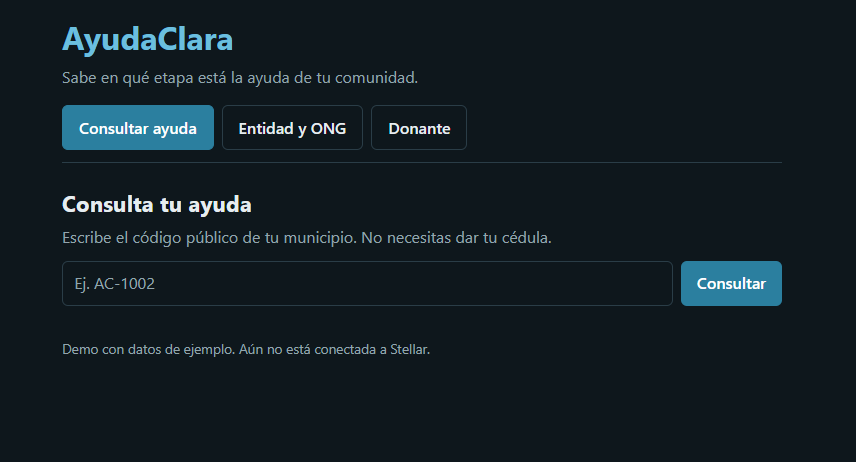
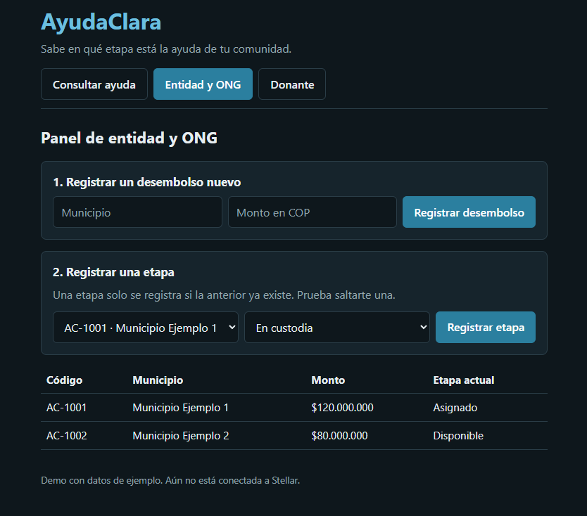
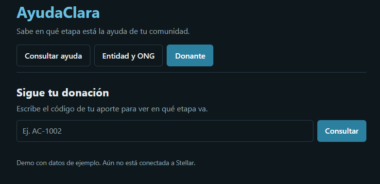

# Documentación — Semana 3: Functional Proof

## Front construido

El front de AyudaClara está en la carpeta `frontend/`. Es una aplicación web hecha con React y Vite que muestra el flujo principal del MVP definido en el Product Blueprint: registrar un desembolso por etapas, consultarlo con un código público y confirmar la entrega por parte de la persona afectada. Por ahora funciona con datos de ejemplo guardados en memoria; la conexión con Stellar se hará cuando exista el contrato.

**Pantallas implementadas**

1. **Consultar ayuda (persona afectada).** La persona escribe el código público de su municipio y ve el monto, la etapa actual y una línea de tiempo con las cuatro etapas: Asignado, En custodia, Disponible y Entregada. No pide cédula ni datos personales. Si el código no existe, muestra "Código no encontrado". Cuando la ayuda está en "Disponible", aparece el botón "Aceptar ayuda"; solo al pulsarlo la etapa pasa a "Entregada". Esta pantalla corresponde a las historias 1 y 4 del backlog.

2. **Panel de entidad y ONG.** La entidad gestora registra un desembolso nuevo (municipio y monto), que queda en "Asignado" y recibe un código público. Luego se puede registrar cada etapa. El panel aplica la regla del Blueprint: una etapa solo se registra si la anterior ya existe; si se intenta saltar una, se rechaza con un mensaje que indica qué etapa falta. La recepción de los recursos ("En custodia") y su entrega ("Disponible") se registran como eventos separados, cada uno con actor y fecha. También hay una tabla con el estado de todos los desembolsos. Corresponde a las historias 2 y 3.

3. **Donante.** El donante escribe el código de su aporte y ve las etapas completadas y la que sigue pendiente, sin datos personales de beneficiarios. Corresponde a la historia 5.

**Cómo se conecta con el MVP.** Las tres pantallas cubren lo que el Blueprint dejó dentro del MVP: registro por etapas sin saltar ninguna, consulta pública por código y aceptación del beneficiario. Lo que quedó fuera del MVP (comparación de montos, panel de organismos de control, reportes descargables) no se implementó.

**Capturas**

## Decisión técnica

**Opción elegida: A, contrato propio.**

El equipo creará un contrato propio en Soroban, el sistema de contratos inteligentes de Stellar. Esta semana solo se deja escrito qué hará; no se escribe ni se despliega código.

**Qué haría el contrato.** Guardaría el estado de cada desembolso (código público, municipio, monto y etapa actual) y el historial de etapas con la cuenta que firmó cada una. Su regla central es que una etapa solo se registra si la anterior ya existe, y que solo una cuenta autorizada para ese rol puede registrarla: la entidad gestora registra "Asignado", la ONG registra "En custodia" y "Disponible", y únicamente la persona afectada puede registrar "Entregada". Así la entrega no puede declararse sin su aceptación.

**Por qué hace falta uno propio.** El Blueprint se apoyaba en un criterio de pertinencia: eliminar al intermediario que hoy concentra la confianza y que varias partes que no confían entre sí compartan un mismo registro. Las herramientas que ya ofrece Stellar, como transferir un activo o crear un balance reclamable, resuelven mover valor, pero no obligan a respetar un orden de etapas entre varios actores ni distinguen quién puede firmar cada una. Esa regla de negocio es el corazón de AyudaClara, y si quedara en el backend, volvería a estar en manos de un solo actor.

**Qué se descartó.** Se descartó usar solo transferencias y balances reclamables, porque no garantizan el orden de las etapas. También se descartó guardar las reglas en el backend con una base de datos tradicional, porque eso replicaría el problema que el proyecto quiere resolver. Los balances reclamables podrían complementar el paso de aceptación del beneficiario; eso se definirá junto con el contrato.

## Participación del equipo

- **Zharick Fetecua** (GitHub: Zharickmich12): asumió el trabajo de esta entrega. Construyó el front (las tres pantallas), tomó la decisión técnica sobre los contratos, redactó esta documentación y el README, y subió los cambios al repositorio.

## Bloqueos y siguiente paso

**Pendiente.** El front usa datos de ejemplo en memoria y los cambios se pierden al recargar la página. Aún no hay conexión con billeteras ni con Stellar, y la identidad de cada rol (entidad, ONG, beneficiario) está simulada. Además, el trabajo de esta entrega recayó en una sola persona del equipo.

**Siguiente paso.** Escribir y desplegar en Testnet el contrato Soroban con las reglas de etapas y roles, conectarlo al front y reemplazar los datos de ejemplo por lecturas de la red.